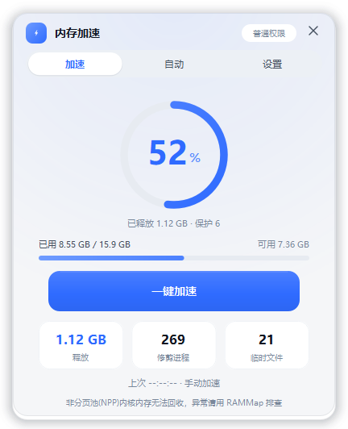
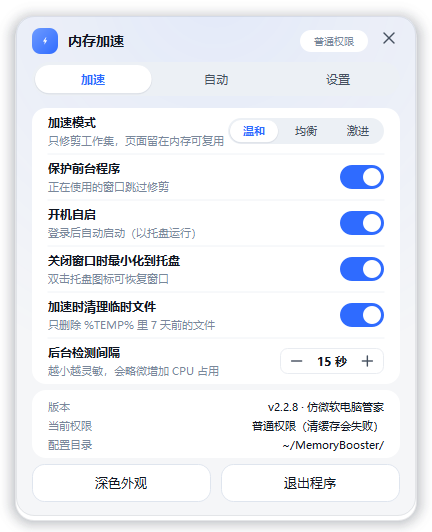

# MemoryBooster · 内存加速

仿微软电脑管家 Boost 的 Windows 内存加速小工具。单文件绿色版，无安装、无后台服务、不写注册表垃圾，用完即走。

 

## 它做什么

| 动作 | 实现 | 需要提权 |
|---|---|---|
| 修剪各进程工作集 | `SetProcessWorkingSetSize(pid, -1, -1)` | 否（管理员能修剪更多进程） |
| 清空系统备用列表 / 缓存 | `NtSetSystemInformation(0x50, MemoryPurgeStandbyList)` | **是**（`SeProfileSingleProcessPrivilege`） |
| 清理老旧临时文件 | 删除 `%TEMP%` 下超过 N 天的文件 | 否 |

## 特性

- **三档加速模式**，按需换挡，避免"一加速就全场卡顿"
  - `温和`（默认）：只修剪工作集，页面留在内存里可复用 → 卡顿最小
  - `均衡`：先清备用列表，再修剪
  - `激进`：先修剪，再清备用列表与系统缓存
- **保护前台程序**：正在使用的窗口跳过修剪，不会把你切走的窗口再抢回来
- **关键进程保护名单**：`explorer / dwm / fontdrvhost / MsMpEng / SearchIndexer / spoolsv` 等一律不动；取不到进程名的一律按"受保护"处理（fail-safe）
- **会话隔离**：只修剪当前登录会话，管理员下不会去捅 Session 0 里的上百个服务进程
- **临时文件限流**：每次最多删 300 个、只动 7 天前的，避免扫盘卡 I/O
- **阈值自动加速**：内存占用超过设定阈值（GB 或百分比）时后台自动加速，带最小间隔节流
- **开机自启双通道**：管理员用「计划任务·最高权限」（免 UAC）；普通权限自动降级到 `HKCU\...\Run`，无需管理员
- **系统托盘常驻**、浅色/深色双主题、无边框圆角窗口
- 引擎零第三方依赖（纯 `ctypes`），Qt 界面用 PySide6

## 直接使用

下载 `MemoryBooster.exe`（单文件，约 27 MB），双击运行即可，无需安装 Python。

## 从源码运行

```bash
py -3.10 -m pip install PySide6
py -3.10 memory_booster_qt.py          # 图形界面
py -3.10 memory_booster_qt.py --tray   # 启动即隐藏到托盘
```

命令行模式（不启动界面）：

```bash
py -3.10 memory_booster_qt.py --once                 # 执行一次加速后退出
py -3.10 memory_booster_qt.py --auto                 # 按阈值后台循环加速
py -3.10 memory_booster_qt.py --once --threshold-gb 8
py -3.10 memory_booster_qt.py --once --threshold-percent 80
```

## 打包

```bash
py -3.10 -m PyInstaller --clean --noconfirm MemoryBoosterQt.spec
```

产物在 `dist/MemoryBooster.exe`。`MemoryBooster.spec` 是早期 Tk 版的配置，保留作对照。

图标由 `make_icon.py` 生成（手写 BMP 帧 + 256px PNG，因为 Windows Shell 只允许 256×256 用 PNG 存放），生成结果以 base64 内嵌进 `app_icon.py`，运行时解到临时文件供窗口和托盘使用。

## 关于自身内存占用

程序本体是 Qt 应用，两个计数器别混着看（实测值）：

| 指标 | 空闲 | 自修剪后 |
|---|---|---|
| 工作集 WorkingSet | 73.6 MB | **9.6 MB** |
| 私有提交 PrivateUsage | 41.2 MB | 41.2 MB |

`EmptyWorkingSet` 只能把页踢出工作集，改不了提交计数。加速完成 2 秒后会调用一次 `_trim_self()`，把自己也修剪一遍——一个内存工具不该自己抱着几十 MB 工作集。

另外，任务管理器里会看到**两个** `MemoryBooster.exe`：占用 9 MB 的那个是 PyInstaller onefile 的引导进程（stub），真正的界面进程是它的子进程。

## 已知限制

- **回收不了非分页池（Non-Paged Pool）内核内存**。那是内核态内存，用户态工具碰不到；有 NPP 泄漏请用 RAMMap / poolmon 定位驱动，或重启。
- 内存"加速"是**短暂回血**：释放掉的内存会被系统和应用很快重新占满。它的价值在于给一次重负载（编译、开大图、切大型游戏）腾出余量，不是"永久扩容"。
- 普通权限下清备用列表会失败（这是设计如此，不是 bug），界面上方会明确标注「普通权限（清缓存会失败）」。

## 目录

```
memory_booster.py      引擎：进程修剪、备用列表清理、临时文件、配置、自启
memory_booster_qt.py   PySide6 界面：加速 / 自动 / 设置 三页
app_icon.py            图标 base64 内嵌（由 make_icon.py 生成）
make_icon.py          ICO 生成器（BMP 帧 + PNG 256）
MemoryBoosterQt.spec   PyInstaller 打包配置（当前）
MemoryBooster.spec     PyInstaller 打包配置（早期 Tk 版）
memory_booster.html    使用说明 / 实现原理文档
```
